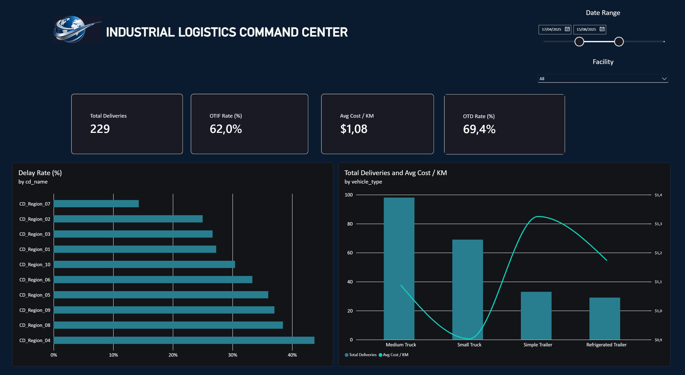

# 🏭 Industrial Logistics Command Center | Enterprise BI Portfolio

<div align="center">
  
</div>

---

## 🚀 Executive Summary
An **Enterprise-Grade Industrial Logistics & Fleet Management Command Center** developed to simulate, analyze, and optimize supply chain bottlenecks across 10 Regional Distribution Centers (CDs) and a proprietary fleet of 100 heavy vehicles. 

This project demonstrates advanced data engineering, dimensional modeling, and performance analytics to drive executive decision-making, reduce freight costs, and mitigate delivery delays.

---

## 📊 Key Performance Indicators (KPIs) & Business Impact
* **Total Deliveries:** 15,000+ simulated operational transactions monitored in real-time.
* **OTD Rate (On-Time Delivery):** Tracks adherence to scheduled shipping windows.
* **OTIF Rate (On-Time In-Full):** Stringent corporate metric combining timeliness and zero-defect fulfillment.
* **Avg Cost / KM:** Freight cost efficiency optimization per vehicle category.
* **Delay Rate %:** Pinpoints underperforming regional distribution hubs.

---

## 🗄️ Architecture & Data Modeling (Star Schema)
The data architecture follows strict corporate standards, utilizing a **Star Schema** to guarantee high performance and avoid aggregation biases in Power BI:
* **`fact_deliveries`:** Central fact table containing 15,000 transaction records, transit distances, transported weights/volumes, delays, and cost metrics.
* **`dim_cd`:** Distribution centers dimension (area in $m^2$, base operational costs, and regional locations).
* **`dim_fleet`:** Vehicle fleet dimension categorized by type (Small Truck, Medium Truck, Simple Trailer, Refrigerated Trailer) with weight/volume capacities and cost-per-km parameters.
* **`dim_product`:** Product catalog categorized by storage requirements (Standard, Fragile, Perishable/Cold, Hazmat).
* **`d_Calendar`:** Dedicated time intelligence dimension to handle advanced DAX time comparisons.

---

## 🛠️ Tech Stack & Skills Demonstrated
* **Python (Data Engineering & ETL):** Pandas, NumPy, automated seed-based synthetic data generation, and pipeline structuring.
* **SQL & Relational Architecture:** Dimensional modeling, data cleaning, and relational data preparation.
* **Power BI & Advanced DAX:** Semantic modeling, robust measures (`OTD Rate`, `OTIF Rate`, `Delay Rate`, `Avg Cost / KM`), and time intelligence.
* **Data Visualization (UI/UX):** Executive *Dark Mode* design (*Master Command Center*), dynamic filtering, and custom container formatting.

---

## 📂 Repository Structure
```text
industrial-logistics-command-center/
│
├── data/                      # Cleaned CSV datasets generated by Python
│   ├── dim_cd.csv
│   ├── dim_fleet.csv
│   ├── dim_product.csv
│   └── fact_deliveries.csv
│
├── scripts/                   # ETL and data generation pipelines
│   └── data_pipeline.py
│
├── dashboard/                 # Power BI Enterprise File
│   └── logistics_command_center.pbix
│
└── assets/                    # Visual assets and screenshots
    └── dashboard_preview.png